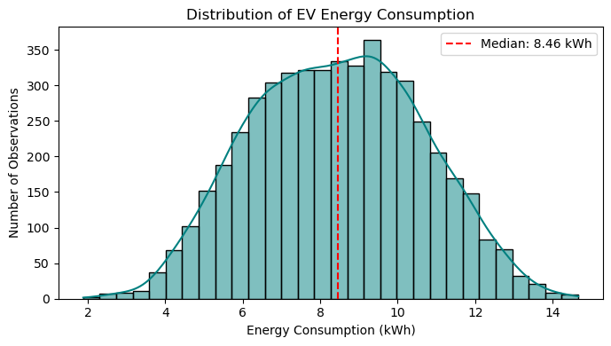
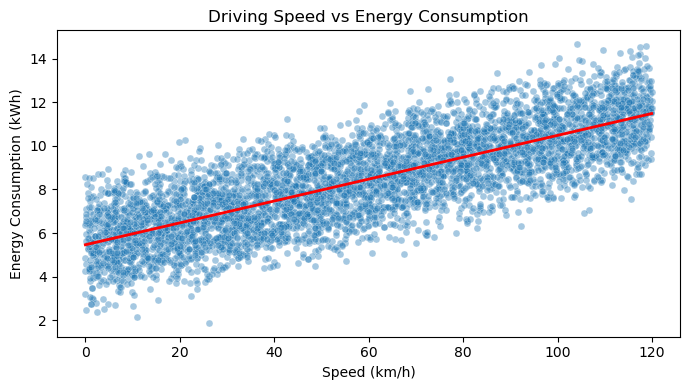
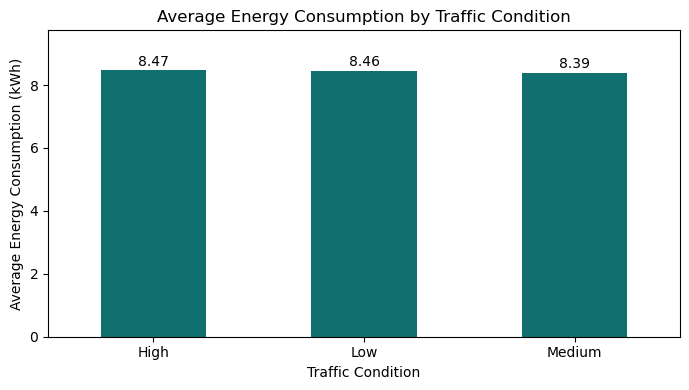
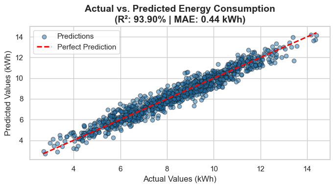

# EV Energy Consumption Prediction using TensorFlow

## Project Overview

This project focuses on predicting Electric Vehicle (EV) energy consumption using a TensorFlow-based regression model. It uses vehicle, driving, road, traffic, weather, and time-related features to estimate energy consumption in kilowatt-hours (kWh).

The project follows an end-to-end machine learning workflow, including data preprocessing, Exploratory Data Analysis (EDA), model development, and performance evaluation.

## Objectives

- Explore the factors associated with EV energy consumption.
- Perform data preprocessing and prepare features for regression.
- Analyze relationships between driving and environmental conditions and energy consumption.
- Build and train a regression model using TensorFlow/Keras.
- Evaluate the model using standard regression metrics.
- Understand the potential of machine learning for EV energy consumption estimation.

## Dataset

The dataset contains approximately 5,000 observations with vehicle, driving, road, traffic, weather, and time-related information.

### Important Features

| Feature | Description |
|---|---|
| `Vehicle_Id` | Identifier of the vehicle |
| `Speed_Kmh` | Vehicle speed in km/h |
| `Distance_Travelled_Km` | Distance travelled in kilometres |
| `Traffic_Condition` | Traffic condition during the trip |
| `Driving_Mode` | Driving mode |
| `Road_Type` | Type of road |
| `Weather_Condition` | Weather during the trip |
| `Temperature_C` | Temperature in degrees Celsius |
| `Timestamp` | Date and time information |
| `Energy_Consumption_Kwh` | Target variable to be predicted |

*Note: The table highlights selected features. Refer to the notebook for the complete dataset schema and preprocessing details.*

## Exploratory Data Analysis (EDA)

EDA was performed to understand the distribution of energy consumption and explore its relationships with driving and environmental variables.

### 1. Energy Consumption Distribution

This histogram helps visualize the distribution of energy consumption values across the dataset.



### 2. Speed vs. Energy Consumption

This scatter plot explores the relationship between vehicle speed and energy consumption.



### 3. Average Energy Consumption by Traffic Condition

This comparison helps examine differences in average energy consumption across traffic conditions.



### 4. Actual vs. Predicted Energy Consumption

This plot compares the actual energy consumption values in the test dataset with the values predicted by the trained TensorFlow model. Predictions closer to the diagonal reference line indicate better agreement.




## Technologies Used

- **Python** — Programming and data analysis
- **Pandas** — Data manipulation and preprocessing
- **NumPy** — Numerical operations
- **Matplotlib** — Data visualization
- **Seaborn** — Statistical visualization
- **Scikit-learn** — Data preprocessing and model evaluation
- **TensorFlow / Keras** — Neural network development and regression
- **Jupyter Notebook** — Experimentation and documentation

## Project Workflow

1. **Data Loading:** Loaded the EV energy consumption dataset.
2. **Data Preprocessing:** Prepared numerical and categorical features for model training.
3. **Exploratory Data Analysis:** Examined distributions, correlations, and relationships between relevant variables.
4. **Feature Preparation:** Prepared the input features and target variable for regression.
5. **Model Development:** Built and trained a TensorFlow-based regression model.
6. **Model Evaluation:** Evaluated predictions using MAE, RMSE, and R².
7. **Visualization:** Used graphs to understand the dataset and compare actual and predicted values.

## Model Performance

The trained TensorFlow regression model was evaluated on the test dataset using the following metrics:

| Evaluation Metric | Result |
|---|---:|
| Mean Absolute Error (MAE) | 0.4371 kWh |
| Root Mean Squared Error (RMSE) | 0.5485 kWh |
| R² Score | 93.90% |

### Interpretation

- **MAE — 0.4371 kWh:** The average absolute difference between actual and predicted energy consumption is approximately 0.4371 kWh.
- **RMSE — 0.5485 kWh:** This metric measures prediction error while penalizing larger errors more heavily.
- **R² — 93.90%:** The model explains approximately 93.90% of the variation in energy consumption in the test dataset.

These results indicate promising performance on the test data. Further validation is required to determine how well the model performs on data from different vehicles, time periods, and operating conditions.

## Key Learnings

- Performing EDA on a real-world-style EV dataset.
- Preparing categorical and numerical features for machine learning.
- Building a regression model using TensorFlow/Keras.
- Evaluating regression performance using MAE, RMSE, and R².
- Visualizing relationships between input features and energy consumption.
- Understanding the importance of testing model generalization on unseen data.

## Conclusion

This project demonstrates an end-to-end machine learning workflow for predicting electric vehicle energy consumption using TensorFlow. The model achieved an R² score of 93.90%, an MAE of 0.4371 kWh, and an RMSE of 0.5485 kWh on the test dataset.

The results suggest that the model can estimate energy consumption from the available input features with promising accuracy. Additional testing on unseen vehicles and different time periods would help evaluate its generalization ability and real-world applicability.

## Project Structure

```text
EV_Energy_consumption_Prediction/
├── README.md
├── EV_Energy_Project.ipynb
├── EV_Energy_Consumption_Dataset_1.csv
└── images/
    ├── energy_distribution.png
    ├── speed_vs_energy.png
    ├── traffic_consumption.png
    └── actual_vs_predicted.png
```


## Future Improvements

- Evaluate the model on additional unseen datasets.
- Compare the TensorFlow model with baseline regression models.
- Tune model architecture and hyperparameters.
- Analyze prediction errors across different driving and environmental conditions.
- Explore feature importance and model interpretability.

## Disclaimer

This project is intended for educational and portfolio purposes. The reported evaluation metrics reflect the test dataset used during experimentation and do not guarantee equivalent performance in real-world EV operating conditions.
